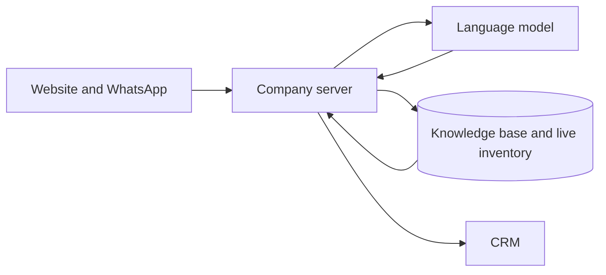

# Real Estate AI Roadmap for Chiriquí

A 90-day technology plan for a real estate brokerage in Chiriquí, Panama, and a working demo of its first pilot: a bilingual assistant that qualifies buyers and explains how purchasing property in Panama works.

- **Live demo:** https://alain507.github.io/real-estate-ai-roadmap/
- **The plan:** [ROADMAP.md](ROADMAP.md)

## What the demo does

1. Talks to a buyer in Spanish or English and asks six qualifying questions: purpose, area, property type, budget, timeline and payment method.
2. Answers free-text questions on the buying process from a knowledge base written and reviewed by a Panamanian attorney: foreign ownership, titled property versus rights of possession, due diligence, the promise contract, closing, costs, financing and payment fraud.
3. Asks for consent before taking contact details, and records when it was given and under which notice version (Panama Law 81 of 2019).
4. Produces a lead file: a score out of 100 with the reasons behind it, a suggested next step, matching listings, and the JSON a CRM would receive.

The listings, prices and names are fictional. The project is not affiliated with any brokerage.

## How it works

The demo is one HTML file with no dependencies, no server and no API keys. Nothing the visitor types leaves the browser.

- **Qualification** is a fixed sequence of questions. Typed answers are matched to options by keyword, and a typed budget such as "250k" is parsed into a range.
- **Questions** are matched against the knowledge base by keyword. When nothing matches, the assistant says so and hands off to a person. It never improvises an answer.
- **Scoring** weighs timeline (35), payment method (30), contact consent (20), defined budget (10) and purpose (5). Leads at 70 or above are hot, 40 to 69 warm, below 40 cold.

## What is deliberately not here

The demo does not call a language model. Calling one straight from a public web page would expose the API key to anyone who opens the page, so the honest version of a static demo is a rule-based one. The production design below adds the model behind a server.

## From demo to production

- **Company server:** holds the API keys, removes personal data the model does not need, limits usage per visitor and logs every conversation for review.
- **Language model:** answers only from the knowledge base and the live inventory. Outside that scope it hands off to an agent.
- **CRM:** receives the same JSON this demo generates and routes the lead to an agent who speaks the buyer's language.
- **People:** an attorney reviews the knowledge base on a schedule, and agents can flag any wrong answer.

## Run it

Open `index.html` in a browser. To publish it, push the repository to GitHub and enable Pages (Settings, Pages, deploy from the `main` branch, root folder).

## Legal note

The information on buying property is general and is not legal advice for a specific case.

## Author

Alain Guerra, attorney (Idoneidad 33617) and cybersecurity technician, Boquete, Chiriquí, Panama.
alain.abogado507@gmail.com, [github.com/Alain507](https://github.com/Alain507)

## License

MIT
